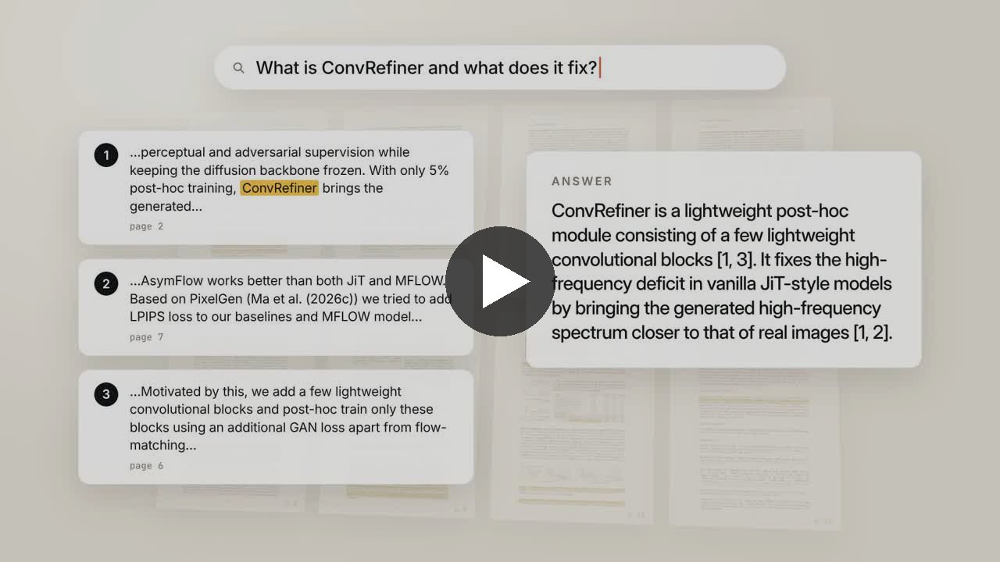
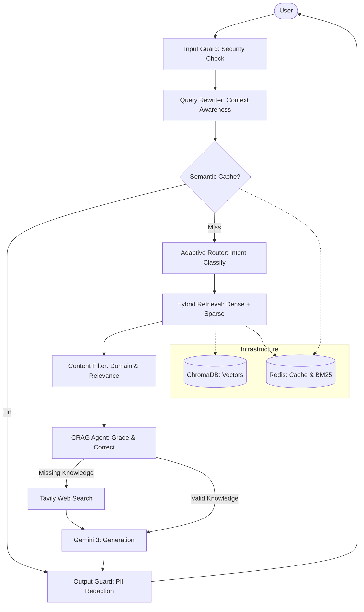
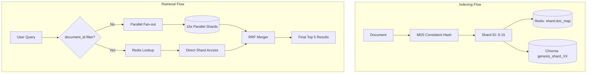
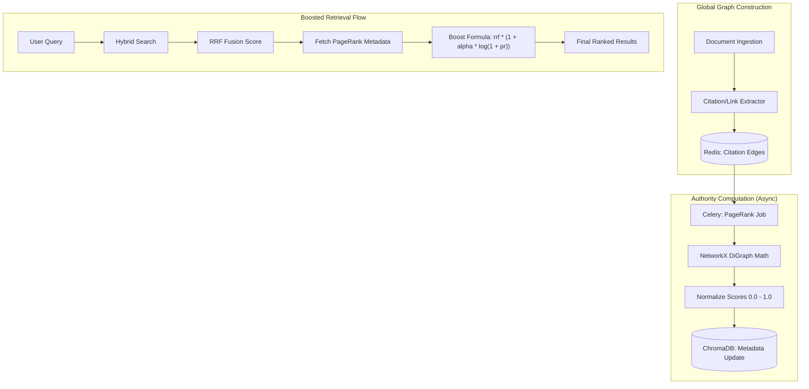

<div align="center">

# 🧠 Genesis RAG

**A retrieval platform you can inspect.** It finds evidence two ways, checks it, ranks it, protects it, and shows its work.

[](https://youtu.be/f4Ia8OKZeOQ)

▶️ **[Watch the product film on YouTube](https://youtu.be/f4Ia8OKZeOQ)** · 🌐 **[Try the live app](https://genesis-rag.onrender.com/)**


[](LICENSE)

Made with ❤️ by **Rohan Malyadri** from **Obscuron X Labs**

</div>

---

## 🎬 The film

Genesis RAG answers questions about your documents and shows exactly where every answer comes from. The film walks through the real app, using a real arXiv paper, in this order:

| Scene | What you see |
|---|---|
| **Upload and indexing** | Text is extracted, split into passages, embedded, and indexed two ways: by meaning and by keywords (43 passages for the demo paper). |
| **Ask a question** | The answer streams in with numbered citations that point to real passages and pages. |
| **Hybrid retrieval** | Dense search (meaning) and BM25 (exact terms) rank passages differently; Reciprocal Rank Fusion (RRF) merges the two lists. |
| **Retrieval Debugger** | Dense, fused, authority and final boosted scores for every passage, across three retrieval modes. |
| **Corrective RAG** | Retrieved passages are graded correct, ambiguous or incorrect, and only good ones reach the model. |
| **Multi-hop reasoning** | A two-part question is split into sub-questions, searched separately, and merged. |
| **Memory and semantic cache** | Follow-ups use earlier turns; a repeated question is answered instantly from the cache. |
| **Sharding** | Documents are hashed to one of 16 ChromaDB shards; queries fan out in parallel and merge with RRF. |
| **PageRank authority** | A citation graph gives well-cited sources a gentle, log-dampened boost. |
| **Security guards** | Prompt injection is stopped before the model; PII is redacted on the way out. |
| **Settings** | Pick the model, number of passages, which guards are on, and whether to show reasoning. |

The film is honest about its limits: Corrective RAG improves the odds of a grounded answer but does not guarantee one, no guard is perfect, and the Neo4j knowledge graph, Tavily web search and Opik tracing are optional and were not part of the demo deployment.

---

## 🏗️ System Architecture



### 🗄️ Multi-Tenant Sharding Architecture

Genesis shards documents across 16 ChromaDB collections with consistent hashing on the **document id**, so every chunk of a document lives on one shard and a document filter queries a single shard.



### 📈 PageRank Authority Architecture

Genesis leverages a global citation graph to inject objective authority scores into the vector search pipeline, overcoming the limitations of pure semantic similarity.



---

## 🌟 Key Features

### 🧠 Agentic intelligence
- **Corrective RAG (CRAG)**: grades retrieved passages and can decompose the question or fall back to Tavily web search when a key is configured
- **Adaptive Router**: zero-shot query classification that adjusts retrieval parameters (Top-K, prompting) to the user's intent
- **Query decomposition and multi-hop reasoning**: splits multi-part questions into sub-queries and merges the evidence
- **Forced Reasoning Mode**: toggle that forces multi-hop decomposition across all architectures (Enterprise, Sharding, PageRank)

### ⚡ Retrieval and scale
- **Hybrid retrieval**: dense (HNSW) plus sparse (BM25) search fused with Reciprocal Rank Fusion
- **Multi-tenant sharding**: 16 ChromaDB shards with MD5 consistent hashing and Redis O(1) shard lookup
- **PageRank authority boosting**: offline citation-graph scores (networkx) applied with a dampened log-boost, plus an Authority Mode toggle
- **Semantic cache**: similarity caching via RediSearch vectors (in-memory fallback)
- **Context awareness**: Redis-backed conversation memory with query rewriting for multi-turn dialogue

### 🛡️ Security
- **Input Guard**: fast regex protection against prompt injection, SQLi and path traversal
- **Content Filter**: domain allowlisting and similarity-based relevance checks
- **Output Guard**: PII redaction with Microsoft Presidio (email, SSN, phone, credit card)
- **API key and rate limiting** on `/api/*`

### 📊 Observability
- **Retrieval Debugger**: inspect Dense, Sparse, RRF and PageRank scores, and compare runs with and without multi-hop reasoning
- **Opik integration** (optional): pipeline tracing and latency metrics

---

## 🛠️ Tech Stack

| Layer | Technology |
|---|---|
| Backend | Python 3.10+, FastAPI, Celery |
| Frontend | Next.js 16, React 19, TypeScript, Tailwind CSS, shadcn/ui, Framer Motion |
| AI | Google Gemini (with automatic model fallback), Sentence-Transformers (`all-MiniLM-L6-v2`) |
| Retrieval | ChromaDB (embedded, 16 shards), BM25 sparse index in Redis, Reciprocal Rank Fusion |
| Cache / memory | Redis (RediSearch vector cache when Redis Stack is used, in-memory similarity cache otherwise) |
| Security | Input guard, content filter, Microsoft Presidio PII redaction, API key + rate limiting |
| Optional | Neo4j + OpenAI (graph reasoning agent), Tavily (web search fallback), Opik (tracing) |

---

## 📂 Project Structure

```text
Genesis/
├── agents/             # Corrective RAG, adaptive router, graph reasoning agent
├── app/                # FastAPI app: config, models, middleware (API key + rate limit)
├── frontend/           # Next.js app (chat, sharding, debugger, PageRank, upload, settings)
├── pipeline/           # Ingestion: extractors, chunker, dedupe, embedder, indexer, PageRank job
├── retrieval/          # Hybrid retriever, sparse (BM25) index, shard manager, reranker
├── routes/             # API endpoints: query (SSE), search, ingest, pagerank, health
├── scripts/dev.sh      # Start/stop Redis + backend + frontend for local development
├── security/           # Input guard, content filter, output guard (PII)
├── services/           # LLM wrapper, semantic cache, conversation memory, grader
├── tools/              # Web search (Tavily)
├── tests/              # pytest suite (runs offline, Gemini is mocked)
└── docker-compose.yml  # Redis Stack, Neo4j, API, Celery worker + beat, frontend
```

---

## 🚀 Quick Start

### Requirements
Python 3.10+, Node 20+, Redis (Redis Stack recommended), and a free
[Gemini API key](https://aistudio.google.com/apikey). System libraries: `libmagic` and (for scanned PDFs / images) `tesseract-ocr`.

### 1. Configure
```bash
git clone https://github.com/rohanmalyadri/Genesis.git
cd Genesis
cp .env.example .env        # then put your GOOGLE_API_KEY in .env
```

### 2a. Run locally (recommended)
```bash
python -m venv .venv && source .venv/bin/activate
pip install -e .            # light install: embeddings run on the ONNX runtime, no PyTorch
python -m spacy download en_core_web_sm
scripts/dev.sh start        # Redis, backend on :8000, frontend on :3000
```
Open **http://localhost:3000**. API docs are at http://localhost:8000/docs. Stop everything with `scripts/dev.sh stop`.

### 2b. Run with Docker
```bash
docker compose up --build
```
Open http://localhost:3000. This also starts Neo4j and the Celery worker + scheduler.

Optional extras: `pip install -e ".[graph]"` (Neo4j knowledge-graph extraction, pulls in PyTorch) and
`pip install -e ".[torch-embeddings]"` (use sentence-transformers instead of ONNX; same vectors, about 1 GB more RAM).

> **Gemini free tier:** the free tier allows only about 20 requests per day per model. A question uses about
> two Gemini calls, and Genesis falls back to other models automatically, but heavy use needs billing enabled.

---

## ☁️ Deploy to Render (free plans)

`render.yaml` describes the whole stack: the **API** (Docker), the **frontend** (Docker, Next.js) and a **Key Value** (Redis) instance.

1. In Render choose **New > Blueprint**, select this repository, and enter your `GOOGLE_API_KEY` when asked.
2. Wait for the three services to build. The frontend URL (`https://genesis-rag.onrender.com`, or similar) is your site.

How it fits together:
- The browser only talks to the frontend. The frontend's server-side proxy (`/api/proxy/*`) forwards to the API and adds a
  secret `API_KEY`, so the API refuses direct calls and no URL or key reaches the browser.
- Embeddings use the ONNX runtime (the same MiniLM vectors as PyTorch), which keeps the API under Render's 512 MB free limit.
- Free-plan limits: the services sleep after 15 minutes without traffic (the first request takes about a minute), and the
  API's disk is wiped on restart. `SEED_DEMO_DOCS=true` re-indexes the sample files in `demo_docs/` on every start; documents
  you upload are lost on restart. A paid plan with a persistent disk keeps them.
- Set `RATE_LIMIT_PER_MINUTE` low (the blueprint uses 20 per visitor) because every question uses your Gemini quota.

---

## 📖 API Reference

| Endpoint | Method | Description |
|---|---|---|
| `/api/v1/query/` | `POST` | Streaming (SSE) answer with sources, trace, and optional multi-hop reasoning |
| `/api/v1/search/` | `GET` | Retrieval debugger: dense, BM25, RRF and PageRank scores (`rerank=true` adds the LLM reranker) |
| `/api/v1/ingest/` | `POST` | Upload and index a document (`use_sharding`, `chunk_size`, `skip_graph`) |
| `/api/v1/pagerank/trigger` | `POST` | Compute PageRank (`inline=true` runs now, otherwise queues a Celery task) |
| `/api/v1/pagerank/stats` | `GET` | Citation-graph statistics and top authority nodes |
| `/health/` | `GET` | Per-service status (Neo4j is optional) |

Set `API_KEY` in `.env` to require an `X-API-Key` header on `/api/*` (and `NEXT_PUBLIC_API_KEY` for the frontend).

---

## 🧪 Testing

```bash
pip install -e ".[dev]"
pytest                      # offline: Gemini and external services are mocked
cd frontend && npm run lint && npx tsc --noEmit && npm run build
```

Manual check: upload a document on **Upload**, ask about it on **Enterprise RAG** (or **Multi-Tenant Sharding**),
compare retrieval modes on **Debugger**, run **PageRank**, and change models and guards in **Settings**.

---

## 🧭 What is and is not included

- **Included and working:** hybrid retrieval, corrective RAG, sharding, PageRank boosting, semantic cache, conversation memory,
  PII redaction, input/content guards, multi-hop reasoning (Gemini query decomposition; the graph ReAct agent is used instead when
  `OPENAI_API_KEY` and Neo4j are available), rate limiting and optional API key.
- **Optional:** Neo4j knowledge graph, Tavily web search fallback, Opik tracing.
- **Not implemented yet:** the roadmap items below (async ingestion queue, HyDE, Graph RAG community summaries, domain modules, evaluation harness).

---

## 🔭 Roadmap

Completed: distributed multi-tenant sharding, PageRank authority pipeline, multi-hop reasoning agent.

Planned:
- **Scale:** async ingestion queue (Celery + Redis Streams), HyDE query expansion
- **Graph RAG:** knowledge-graph extraction, community summarization
- **Legal:** citation parser, clause-level chunking, privilege detection, regulatory change tracker
- **Medical:** UMLS normalization, PICO extraction, drug interaction graph, HIPAA compliance layer
- **Agentic:** long-context deep-read mode, tool-use planning agent, proactive research agent, feedback learning loop

---

## 📄 License

Released under the [MIT License](LICENSE). Copyright (c) 2026 Rohan Malyadri, Obscuron X Labs.
